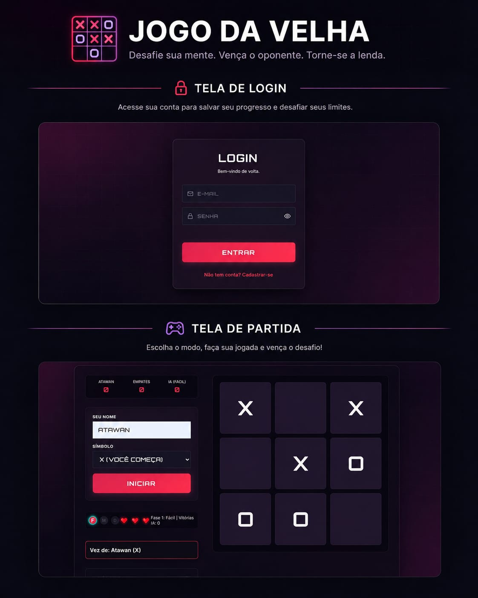

# 🎮 Jogo da Velha - Campaign Edition

Um Jogo da Velha moderno e desafiador, com interface futurista e um modo campanha contra inteligência artificial.

## 🚀 Visualizar Projeto

O projeto está disponível online para ser testado agora mesmo:
👉 **[Acesse aqui o Jogo da Velha](https://jogodavelhaonline.vercel.app/)**

## 📸 Preview

<div align="center">
  
  <p><em>Interface escura com temática "Wine" e efeitos de neon.</em></p>
</div>

## 🧠 Objetivo

Este projeto foi desenvolvido com o propósito de **exercitar a lógica de programação avançada em JavaScript**. Ao contrário de um jogo tradicional, este projeto explora:

- **Algoritmos de IA:** Implementação de níveis de dificuldade, incluindo o algoritmo **Minimax** para tornar a IA imbatível no modo difícil.
- **Persistência de Dados:** Uso de `localStorage` para salvar o progresso da campanha (fase, vidas e vitórias) no próprio navegador, sem banco de dados nem backend.
- **Manipulação de DOM:** Gestão dinâmica de estados da interface (jogo e modais).
- **Clean Code:** Estruturação da lógica utilizando Programação Orientada a Objetos (Classes).

## ✨ Funcionalidades

- 🏆 **Modo Campanha:** Três níveis de dificuldade (Fácil, Médio e Difícil).
- ❤️ **Sistema de Vidas:** O jogador possui tentativas limitadas para vencer a IA.
- 🤖 **IA Inteligente:** Desde movimentos aleatórios até estratégias otimizadas.
- 📊 **Placar em Tempo Real:** Acompanhamento de vitórias, derrotas e empates.
- 📱 **Design Responsivo:** Otimizado para dispositivos móveis e desktops.

## 🛠️ Tecnologias

As seguintes tecnologias foram utilizadas na construção deste projeto:

*   🌐 **[HTML5](https://developer.mozilla.org/pt-BR/docs/Web/HTML)**: Estruturação semântica do conteúdo.
*   🎨 **[CSS3](https://developer.mozilla.org/pt-BR/docs/Web/CSS)**: Estilização e responsividade da interface.
*   🚀 **[JavaScript](https://developer.mozilla.org/pt-BR/docs/Web/JavaScript)**: Lógica de programação e interatividade do jogo.
O jogo é um site estático: não usa backend, banco de dados, contas de usuário nem dependências externas.

> **Sobre o progresso salvo:** a fase atual, as vidas restantes e o total de vitórias ficam salvos apenas no navegador e no dispositivo em que você joga. Limpar os dados do site, usar uma janela anônima ou trocar de navegador/dispositivo começa uma nova campanha. O placar da sessão (vitórias, derrotas e empates) zera ao recarregar a página.

## ▶️ Como executar

Se desejar rodar o projeto localmente para estudo ou modificações, siga os passos abaixo:

1. **Clone o repositório:**
   ```bash
   git clone https://github.com/seu-usuario/jogo-da-velha.git
   ```

2. **Entre na pasta do projeto:**
   ```bash
   cd jogo-da-velha
   ```

3. **Sirva os arquivos com qualquer servidor estático** (necessário porque o script usa módulos ES):
   ```bash
   npx serve .
   ```
   Ou use a extensão *Live Server* do VS Code.

4. **Acesse no navegador** o endereço exibido pelo servidor (ex.: `http://localhost:3000`).

---

<div align="center">
  <p>Desenvolvido por <a href="https://github.com/atawancazetta">Atawan Cazetta</a>e<a href="https://github.com/fernandoaguiardev">Fernando Aguiar</a></p>
</div>
